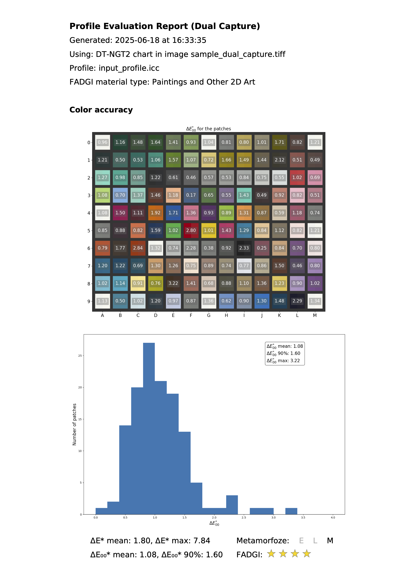

# Arte-Profiler

**Version: 0.1-beta**  

## Overview

**arte-profiler** is a Python-based tool that simplifies the usage and extends the functionality of Argyll CMS for camera profiling and color accuracy evaluation. The software is designed primarily for use in cultural heritage digitization but can be useful also for other applications requiring precise color reproduction. The tool provides both a command-line interface (CLI) and a programmatic API, enabling integration into automated imaging workflows or standalone usage.

The program supports three primary use cases:

1. **Generating a color profile** from an image of a supported color chart.
2. **Evaluating an existing ICC profile** using an image of a supported color chart.
3. **Generating and evaluating a color profile** in a single run, either from an image that contains two different supported charts or from two separate images. In this last case, one chart is used to generate the color profile, while the other one assesses its accuracy.

In all cases, arte-profiler generates a structured **PDF report** summarizing the results based on the **Metamorfoze** (version 1) and **FADGI** (third edition) imaging guidelines.

## Output Reports

arte-profiler generates structured PDF reports that include:

- ΔE*₀₀ for each patch in a chart
- A histogram of the ΔE*₀₀ values
- Compliance checks for Metamorfoze and FADGI guidelines (color accuracy, oecf, white balance).
- An appendix with information relative to the patches values extraction

**Example evaluation report, page 1 of 4:** patch-level color differences, summary
statistics, and guideline assessments. Subsequent pages cover OECF, white balance,
and patch-extraction diagnostics.



## Supported targets

arte-profiler supports the following standard color charts:

- **ColorChecker Digital SG**
- **ColorChecker Passport**
- **Digital Transitions Next Generation Target, Version 2 (DT-NGT2)**

The tool bundles all necessary reference data for target recognition and profiling, including:

- A reference image of the target
- The pixel coordinates of fiducial marks on the reference image
- Data defining the geometric layout of the target
- Generic L\*a\*b\* reference values for each patch (sourced from manufacturer data)

While these generic L\*a\*b\* values provide a practical baseline for profiling, **using chart-specific measurements is recommended for optimal accuracy.** New targets can also be included by adding their reference data.

## Installation

Use a terminal on macOS or Linux, or PowerShell on Windows. These steps work with or without
an existing Python installation: uv provides Python 3.11 and manages a virtual
environment for this repository, without requiring a separate Python installation.
ArgyllCMS is bundled; on Apple Silicon Macs, its executables require Rosetta 2.
On managed computers, consult IT if security policies block installation or execution.

1. **Install uv** using the [official installation instructions](https://docs.astral.sh/uv/getting-started/installation/).
   If `uv --version` already works, skip the installer commands.

    macOS and Linux (bash or zsh):

    ```bash
    curl -LsSf https://astral.sh/uv/install.sh | sh
    ```

    Windows (PowerShell):

    ```powershell
    powershell -ExecutionPolicy ByPass -c "irm https://astral.sh/uv/install.ps1 | iex"
    ```

    Open a new Terminal window (macOS/Linux) or PowerShell window (Windows), then verify:

    ```sh
    uv --version
    ```

2. **Get the source code.** Download the [repository](https://github.com/amarrocc/arte-profiler)
   using **Code → Download ZIP**, extract it, and open your terminal in the extracted
   folder (usually `arte-profiler-main`) containing `pyproject.toml`. If you already
   have Git, you can instead run:

    ```sh
    git clone https://github.com/amarrocc/arte-profiler
    cd arte-profiler
    ```

3. **Install Python and Arte-Profiler.** Leave any active Python or Conda environment
   first (`deactivate` or `conda deactivate`, as appropriate), then run these commands
   from the repository folder:

    ```sh
    uv python install 3.11
    uv venv --python 3.11
    uv pip install -e ".[gui]"
    ```

    This creates `.venv` and installs the scientific Python API, command-line interface
    (`arte-profiler`), and graphical interface (`arte-profiler-gui`), with their
    dependencies from `pyproject.toml`.
    Editable installation keeps the package linked to this source folder, so edits
    to Python source files take effect without reinstalling. Keep the folder in place.

4. **Activate the environment.**

    macOS and Linux (bash or zsh):

    ```bash
    source .venv/bin/activate
    ```

    Windows (PowerShell):

    ```powershell
    .\.venv\Scripts\Activate.ps1
    ```

5. **Verify the installation.** With the environment active:

    ```sh
    python --version
    arte-profiler --help
    ```

    Expect Python 3.11.x and the CLI's usage/options.
    The help command may take a moment, especially on the first run while libraries initialize.

6. **Recommended first-run check (all platforms).** With the environment active,
   run the Python examples from the repository folder:

    ```sh
    python examples/sample_api_usage.py
    ```

    The script runs three workflows and may take a few minutes. Check that ICC profiles
    and PDF reports are generated under `examples/output/` and open the PDFs.

    **macOS:** If a bundled ArgyllCMS tool (`scanin`, `colprof`, or `icclu`) is blocked
    because its developer cannot be verified, approve your trusted download through
    **System Settings → Privacy & Security → Open Anyway**, then rerun the example.
    See [Apple's instructions](https://support.apple.com/en-gb/102445).

Run `deactivate` to leave the environment. In a later terminal session, return to
the repository folder and repeat the activation command for your operating system;
there is no need to repeat installation.

## Graphical interface

After installation, activate the environment and launch the graphical interface:

```sh
arte-profiler-gui
```

The interface opens in your web browser at <http://127.0.0.1:8080>.
It runs locally, and all scientific processing stays on your computer.

Choose a workflow:

- **Create and evaluate a profile:** select a profiling TIFF and target type to
  generate an ICC profile and creation report. Optionally evaluate another target
  type in the same TIFF or a separate TIFF. Use a target with different color
  patches for an independent assessment of accuracy.
- **Evaluate an existing profile:** select an existing ICC profile, an evaluation
  TIFF, and its target type to generate a color accuracy evaluation report.

Use **Browse** or enter file paths. For profile creation, **Advanced settings** provides:

- **Custom CIE references (optional):** select chart-specific measurements, or leave
  blank to use generic reference values.
- **Profile algorithm:** Gamma + matrix (default), Shaper + matrix, Matrix (linear
  curves), Lab LUT, or XYZ LUT.
- **Profile complexity:** Low, Medium (default), or High.

For evaluation, optional CIE references remain under **Advanced options**; leave
them blank to use generic reference values.

Choose a **Results folder** in **Save results**, review the selections, and click
**Run**. Generated ICC profiles, PDF reports, logs, and supporting files are saved
in that folder; the interface shows the processing log and links to completed results.

Keep the launching terminal open. To stop the application, wait for processing to
finish, then press **Ctrl+C** in that terminal or PowerShell window. Closing the
browser tab alone does not stop it. To launch it again later, activate the environment
and run `arte-profiler-gui` again.

## Command-Line Usage

After installation, a script named `arte-profiler` will be available in your environment. You can run:

```bash
arte-profiler --help
```
For profile creation, `--profile-algorithm` selects `g` (gamma+matrix, default),
`s` (shaper+matrix), `m` (linear matrix), `l` (Lab cLUT), or `x` (XYZ cLUT).
`--profile-complexity` selects `l` (low), `m` (medium, default), or `h` (high),
controlling fitting effort/curve detail or LUT resolution. Higher complexity does
not guarantee better color accuracy; assess alternatives using an independent
target. See the [ArgyllCMS colprof documentation](https://www.argyllcms.com/doc/colprof.html)
for details of the corresponding `-a` and `-q` options.

### Basic Examples

Replace the placeholders below with your paths, target types, and supported
algorithm and complexity values.

#### 1. **Generate a profile from a single chart image**

The CIE arguments are optional; omit them to use generic reference values.
The algorithm and complexity options are also optional and default to `g` and `m`, respectively.

```bash
arte-profiler \
  --build_tif path/to/chart_image.tiff \
  --build_type chart_type \
  --profile-algorithm profile_algorithm \
  --profile-complexity profile_complexity \
  --build_cie path/to/custom_chart.cie \
  --test_tif path/to/chart_image.tiff \
  --test_type chart_type \
  --test_cie path/to/custom_chart.cie \
  -O output_folder
```

This command:
1. Builds a new ICC profile from `chart_image.tiff` which contains a chart of type `chart_type`.
2. Evaluates it against the same image (to verify that the profile was correctly generated and applied).
3. Saves a report and intermediate files in `output_folder`.

**N.B.:** The generated report primarily serves to verify that the profile was correctly generated and applied, rather than to provide a rigorous evaluation of its performance. **Assessing profile accuracy using an independent target** (i.e. one with different patches than the one used for profiling) **is strongly recommended** to mitigate the risk of overestimating color accuracy.

#### 2. **Evaluate an existing ICC profile**

The CIE argument is optional; omit it to use generic reference values.

```bash
arte-profiler \
  --test_tif path/to/chart_image.tiff \
  --test_type chart_type \
  --test_cie path/to/custom_chart.cie \
  --in_icc path/to/existing_profile.icc \
  -O output_folder
```
This command:
1. Evaluates `existing_profile.icc` using `chart_image.tiff` which contains a chart of type `chart_type`.
2. Saves a report and intermediate files in `output_folder`.

#### 3. **Generate and evaluate a color profile in a single run**

The CIE arguments are optional; omit them to use generic reference values.
The algorithm and complexity options are also optional and default to `g` and `m`, respectively.

```bash
arte-profiler \
  --build_tif path/to/chartA_image.tiff \
  --build_type chartA_type \
  --profile-algorithm profile_algorithm \
  --profile-complexity profile_complexity \
  --build_cie path/to/custom_chartA.cie \
  --test_tif path/to/chartB_image.tiff \
  --test_type chartB_type \
  --test_cie path/to/custom_chartB.cie \
  -O output_folder
```
This command:
1. Builds a new ICC profile from `chartA_image.tif` which contains a chart of type `chartA_type`.
2. Evaluates the newly build input profile against the same image (to verify that the profile was correctly generated and applied).
3. Saves a (first) creation report and intermediate files in `output_folder`.
4. Evaluates the newly build input profile against `chartB_image.tif` which contains a different chart (`chartB_type`).
5. Saves a (second) evaluation report and and intermediate files in `output_folder`.

**Note**: In this example, the `build_tif` and `test_tif` parameters refer to two separate image files; alternatively, a single image (i.e. `build_tif` and `test_tif` are the same file) that contains two different supported charts can be used.

### Example script

For more complete CLI usage scenarios, see the example script [`examples/cli_example.sh`](examples/cli_example.sh)

## Programmatic Usage

### Building an ICC Profile

`profile_algorithm` and `profile_complexity` are optional and default to `"g"`
and `"m"`, respectively. Omit `chart_cie` to use generic reference values.

```python
from arte_profiler.profiling import ProfileCreator

creator = ProfileCreator(
    chart_tif="path/to/build_image.tiff",
    chart_type="build_chart_type",
    folder="output_folder",
    profile_algorithm="profile_algorithm",
    profile_complexity="profile_complexity",
)
creator.build_profile()
```

### Evaluating a Profile

```python
from arte_profiler.profiling import ProfileEvaluator

evaluator = ProfileEvaluator(
    chart_tif="test_image.tiff",
    chart_type="test_chart_type",
    in_icc="my_profile.icc",
    folder="output_folder"
)
evaluator.evaluate_profile()
```

### Example script

For more complete API usage scenarios, see the example script [`examples/sample_api_usage.py`](examples/sample_api_usage.py)

## Dependencies

arte-profiler requires the following dependencies:

- `colour-science`
- `scipy`
- `matplotlib`
- `numpy`
- `opencv-python`
- `pandas`
- `imageio`
- `tifffile`
- `imagecodecs`
- `pyyaml`
- `reportlab`
- `seaborn`
- `shapely`

Dependencies are installed automatically; see [`pyproject.toml`](pyproject.toml) for version requirements.

## License

arte-profiler is released under **GNU General Public License**. See `LICENSE` for details.

## Authors

- **Alessandra Marrocchesi** - *Lead Developer*
- **Robert G. Erdmann** - *Contributor*

## Acknowledgments

arte-profiler integrates ArgyllCMS, which is distributed with the package.

## Contributions

Contributions are welcome. Please open an issue or submit a pull request on [GitHub](https://github.com/amarrocc/arte-profiler).


